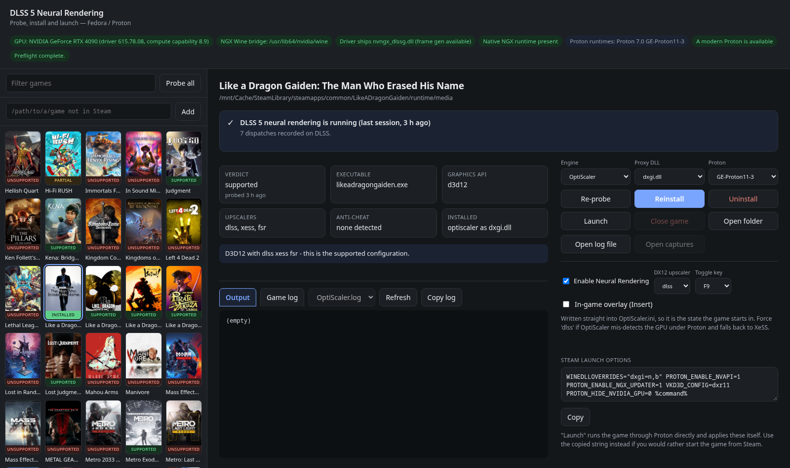
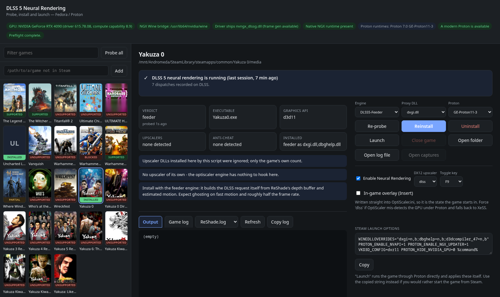

# dlss5-linux

DLSS 5 "Neural Rendering" on Fedora/Linux via Proton, on an RTX 40 (Ada) card —
and, experimentally, on AMD RDNA2/3/4 through a third-party ZLUDA port (see
[Supported GPUs](#supported-gpus)).

This is the `linux/` directory of a fork of
[yumlevi/renodx-dlss-installer](https://github.com/yumlevi/renodx-dlss-installer).
The repository root is that project and its README: a Windows-only C# WPF
installer. Nothing here replaces it — this directory is a second implementation
of the same idea, for people playing the game on Linux under Proton.

The upstream repo is ~99% a vendored copy of
[crosire/ReShade](https://github.com/crosire/reshade); the only original logic is
`../reshade/setup/MainWindow.Custom.cs`, and it does nothing but copy files. The
scripts here do the same file placement natively on Linux, plus the Proton wiring
the Windows installer never had to think about.

## Quick start

Every path below is relative to this directory.

```bash
cd linux
./dlss5-gui.py                                    # web GUI: scan, probe, install, launch
```

Or from the shell:

```bash
./dlss5-linux.sh --check                          # preflight only
./dlss5-linux.sh --game-dir=/path/to/game --probe # will this game work?
./dlss5-linux.sh --game-dir=/path/to/game         # install (optiscaler engine)
./dlss5-linux.sh --game-dir=/path/to/game --engine=amd   # AMD GPU, experimental
./dlss5-linux.sh --game-dir=/path/to/game --uninstall
```

Then set the launch options the script prints, and pick GE-Proton under
Properties → Compatibility.

`--help` lists every option. Three that the examples above do not show:

| Flag | Effect |
|---|---|
| `--dry-run` | Print every download, copy, extraction, deletion and ini edit that would happen. Changes nothing on disk. Combines with `--configure`, `--uninstall` and `--install-proton`. |
| `-y`, `--yes` | Answer prompts yes. There is one: "an install already exists here, uninstall first?" |
| `-h`, `--help` | The full option list, then exit. |

## Supported GPUs

The script reads which GPU you have from `/sys/class/drm` — not from
`nvidia-smi`, which only exists with NVIDIA's driver — and refuses an engine
that cannot run on it before downloading anything. A laptop with an integrated
and a discrete GPU is judged by the one games render on: NVIDIA first, then a
discrete AMD, then an AMD APU, then Intel. `--check` lists every GPU it found.

| GPU | Status | Engine |
|---|---|---|
| **NVIDIA RTX 40 (Ada)** | The tested path. Everything else in this README is about it. | `optiscaler` (default), `reshade`, `feeder` |
| NVIDIA RTX 50 (Blackwell) | Installs, but the downloaded `nvngx_dlssnr.dll` is Ada-patched (`sm_89` only) and will not initialise. `--check` says so; use the driver's own `nvngx_dlssnr.dll` instead. | same |
| NVIDIA RTX 20/30 | Same patched DLL, same failure. Not supported. | — |
| **AMD RDNA3 / RDNA4** (RX 7000 / RX 9000) | **Experimental**, through RedDukeDev's port. Untested by us — there is no AMD card here. | `amd` only |
| AMD RDNA2 (RX 6000) | Installs with `--engine=amd`, but upstream reports "the performance impact is huge" and too many artifacts to enjoy. | `amd` only |
| Older AMD (RDNA1, Vega, GCN APUs) | Not covered by the package's translation cache. Refused. | — |
| Intel | Not supported yet. The one community proof of concept, on Arc Xe2, runs at 3–5 fps on Windows only; there is nothing to install. | — |

On AMD, the AMD generation comes from the `gfx_target_version` the kernel
publishes under `/sys/class/kfd` (`110000` is `gfx1100`, an RX 7900). That
target is checked against the `coverage.txt` the package ships beside its
translation cache — `gfx10-3-generic gfx11-generic gfx1100 gfx1101
gfx12-generic` in 1.1.0 — because the plugin refuses, at run time, a GPU its
cache does not hold rather than translating the network in game.

`--force` overrides a refusal, for when the detection has it wrong. It does not
make an NVIDIA engine work on AMD: those need NVIDIA's NGX runtime, which no
other driver has.

## Desktop app and packages

`./dlss5-app.py` is the same GUI in its own window (GTK 4, libadwaita and
WebKitGTK 6 through PyGObject) instead of a browser tab. Without those libraries
it says what is missing and opens the system browser, exactly like
`./dlss5-gui.py`; `--browser` does that on purpose.

Installed from a package, the commands are:

```bash
dlss5-linux-gui        # the desktop app; also "DLSS 5 for Linux" in the app menu
dlss5-linux --help     # the CLI, i.e. dlss5-linux.sh
```

Closing the window while an install, uninstall or launch is still running asks
first: the job would otherwise be cut off mid-way. "Close When Finished" hides
the window and exits once the last job ends.

Prebuilt packages are on the
[Releases page](https://github.com/MiguelCarino/renodx-dlss-installer/releases):
download the `.noarch.rpm` and `sudo dnf install ./dlss5-linux-*.noarch.rpm`, or
download the `.AppImage`, `chmod +x` it and run it. To build them yourself:

Build an RPM (needs `rpm-build`, `desktop-file-utils` and `python3`, no root)
and install it:

```bash
packaging/build-rpm.sh
sudo dnf install ./packaging/dist/dlss5-linux-0.0.2-1.*.noarch.rpm
```

The RPM pulls in the CLI's tools (curl, unzip, binutils, 7z, xdg-utils) and only
recommends the GTK/WebKit libraries, since the app works without them.

Or an AppImage, a single file that needs no root to run:

```bash
packaging/appimage/build-appimage.sh
chmod +x packaging/dist/DLSS5_for_Linux-0.0.2-x86_64.AppImage   # if the copy lost it
packaging/dist/DLSS5_for_Linux-0.0.2-x86_64.AppImage             # the desktop app
packaging/dist/DLSS5_for_Linux-0.0.2-x86_64.AppImage cli --help  # the CLI
ln -s "$PWD/packaging/dist/DLSS5_for_Linux-0.0.2-x86_64.AppImage" ~/.local/bin/dlss5-linux
dlss5-linux --help                                               # the CLI by its usual name
```

The AppImage carries only these scripts, not Python or GTK, so the host
provides the same things the RPM would install: `python3`, `bash`, `curl`,
`unzip`, `binutils` (objdump), 7z (`p7zip-plugins` / `7zip` on Fedora,
`7zip` or `p7zip-full` on Debian/Ubuntu) and `xdg-utils`; and for the native
window, optionally, PyGObject with GTK 4, libadwaita and WebKitGTK 6.0
(`python3-gobject gtk4 libadwaita webkitgtk6.0` on Fedora). Without those it
opens in your browser.

On a host without FUSE (libfuse2) run it with `--appimage-extract-and-run`
first, e.g. `DLSS5_for_Linux-0.0.4-x86_64.AppImage --appimage-extract-and-run cli --help`.
The AppImage runtime leaves its extract (`appimage_extracted_<hash>`, about
250 KB, one per AppImage build) in `$TMPDIR` or `/tmp` after it exits; delete those by hand.

Both builds write to `packaging/dist/`.

## Web GUI

`./dlss5-gui.py` serves a local page that walks every Steam library, probes each
installed game, and installs/uninstalls/launches without you typing a path.
Standard library only — no pip, no venv.



*A game with its own DLSS. The cover grid shows each game's verdict; the banner
reads the injector's log and says whether the neural pass actually ran.*



*A game with no DLSS. Yakuza 0 probes as `feeder`; installed with the feeder
engine it ran the neural pass at 3440x1440 under Proton — about 306,000 frames
delivered in an hour-long session. Its launch options override both proxies and
Microsoft's `d3dcompiler_47`.*

It binds to `127.0.0.1` and mints a fresh token per run; the URL printed in the
terminal is the only way in. Install is disabled outright for any game where the
probe finds anti-cheat.

"Launch" (launch with overrides) runs the game through Proton directly, with the
environment applied by the GUI process, so nothing edits Steam's config files.
It sets `SteamAppId` / `SteamGameId` / `STEAM_COMPAT_APP_ID` so `steam_api64.dll`
can still attach to the running Steam client, and `STEAM_COMPAT_MOUNTS` so the
library gets a drive letter instead of being reached through `Z:\`.

**Games with Denuvo or strict Steam DRM will still refuse a launch that did not
come from Steam** — they exit within a second, before creating a graphics device,
which makes it look like the injector failed when it never got a chance to run.
For those, copy the Steam launch-option string instead and start from Steam. The
GUI flags this: a launch that ends in under 15 seconds gets an explicit note.

```
./dlss5-gui.py --port 8777 --no-open
```

### Games Steam does not list

The list is Steam's libraries plus anything you add by hand, so a GOG, Heroic,
Epic or loose Wine install is reachable too. Type the folder into the box above
the list and press Add (or Enter); the × on its row forgets it again and deletes
nothing. Added folders persist in `~/.config/dlss5-linux/folders.json`.

Give it the **game root**, the same directory you would pass to `--game-dir` —
the probe resolves the binary directory below it, and anti-cheat is scanned from
the root down.

Three folders are refused: one that does not exist, one already covered (a Steam
game, or a subfolder of something added earlier), and `$HOME` or anything above
it. The last matters because an added folder becomes a base for the containment
checks that keep **Open folder** and log reading inside known game directories —
a folder containing everything would be the end of them.

An added game has no Steam appid, so `SteamAppId` and friends are not set for
it — nothing to attach to — and it gets a Wine prefix of its own under
`~/.local/share/dlss5-linux/prefixes/`, named after the folder and a digest of
its path, rather than borrowing a `compatdata` directory it does not have.
`STEAM_COMPAT_MOUNTS` points at the folder's own parent for the same reason.

A folder that is later moved, deleted or left on an unmounted disk shows as
`missing` instead of being probed, and drops out of the open/log allowlist until
it is back.

### Layout

The detail pane was capped at 900px, which on a wide window left a third of it
empty while the six fact tiles wrapped to a second row and every control stacked
down the middle. Above 1200px it is now two columns: what you read on the left
(status, facts, reasons, and the log under them), what you act on down the right
(engine and Proton, install and launch, the ini settings, the launch string).
Below 1200px it stacks in the original order.

The log sits under the left column rather than under both, because the controls
column is the taller of the two and leaving the log below everything put it past
the fold with 400px of nothing above it.

### Is it actually working

Installed and working are different things, and the difference is only ever
visible in `OptiScaler.log`: the injector can load, hook the game and still
never dispatch the neural pass. The page reads that log and says which happened,
in a banner above the facts:

| | Meaning |
|---|---|
| ✓ **DLSS 5 neural rendering is running** | `DlssNr_Dx12::Dispatch` in the log, on the DLSS backend. This is the one you want. |
| ! **Running, but on XeSS instead of DLSS** | The pass is dispatching, but OptiScaler fell back — usually the NVAPI race above. Set the DX12 upscaler to `dlss` and relaunch. |
| ✗ **Injector loaded, neural pass never ran** | OptiScaler started and DLSS-NR was never dispatched. Neural rendering is off, or the game gave it nothing to hook. |
| ✗ **OptiScaler never loaded** | A log with no startup banner. The proxy DLL was not loaded — check `WINEDLLOVERRIDES`. |

A log with nothing running and no write for two minutes is labelled as the last
session with its age, so an old success cannot be mistaken for a live one.

### Changing settings while the game runs

You cannot, from here — and the page now says so rather than saving a change
that appears to do nothing.

OptiScaler reads `OptiScaler.ini` **once, at startup**. It imports no file-watch
API (`ReadDirectoryChangesW`, `FindFirstChangeNotification` — neither is in its
import table) and exposes no reload action; its overlay offers *Save Settings*,
never *Load*, and its own restart-required message is "Save INI and restart to
apply the changes". So an edit made mid-session is real on disk and reaches the
next launch, not the one already running.

The live path is OptiScaler's own overlay — **Insert**, or **Home** on the
reshade engine. Per the ini's documentation, everything under `[DlssNr]` is live
there except `Preset`, which is baked in when the model is created.

While a game is running, the note under the config controls says this and names
the overlay key for the installed engine — or, with the overlay off, says to
relaunch instead.

### The overlay is off by default

An optiscaler install writes `[Menu] OverlayMenu=false`. The overlay menu brings
OptiScaler's input layer with it — window-subclass, raw-input, DirectInput and
XInput hooks — and in Like a Dragon Gaiden an 8BitDo controller connecting a few
seconds after launch, while those hooks were going in, deadlocked Wine's
`xinput_cs` critical section. The game's main thread waited on it forever and
the window stayed black (Proton log: `RtlpWaitForCriticalSection ... xinput_cs
wait timed out in thread 0124, blocked by 0150`). With the menu off the same
controller connected mid-game and worked.

The hooks are not strictly gone with the menu off — OptiScaler still installs
them once the game creates its upscaler — but they go in after startup instead
of during it, which is what was observed to matter. One run each way, so treat
this as the likely cause rather than a proven one.

Nothing the neural pass needs lives in the menu: `[DlssNr] Enabled` and the DX12
upscaler are ini settings the GUI writes, and switching it in game does not need
the menu either — see the toggle key below. Turn the overlay back on per game with
`--configure --overlay=on` or the **In-game overlay** checkbox; you lose
OptiScaler's frame generation with it off, which none of the tested games used.

### Switching it in game: F9

Installs bind `[DlssNr] ToggleKey=0x78`, so **F9** turns the neural pass on and
off mid-game with the overlay off. Change it with `--toggle-key=F1..F12|none|0xNN`
or the GUI's **Toggle key** menu.

The key belongs in `[DlssNr]`. The ini OptiScaler ships documents `ToggleKey`
under `[FrameGen]`, but it is never read from there: with it set under
`[FrameGen]` the startup "Config parameters" list did not include it and F9 did
nothing; moved to `[DlssNr]`, the list shows `DlssNr.ToggleKey: 0x78` and F9
works. In `dxgi.dll` the key's name sits with the other `DlssNr` keys, not the
frame-generation ones. The template has no `[DlssNr]` line for it, so the
installer adds one.

The other `[DlssNr]` controls — `TransferStrength`, `Intensity`, `LocalTone`,
`MaxRatio` and the rest — are only live in the overlay; without it they apply
at the next launch.

### Reinstalling keeps your settings

The package ships its own `OptiScaler.ini`, and extracting it used to replace
the old one wholesale — so a **Reinstall** handed neural rendering back switched
off, which is what made Control stop working right after one. Now every key that
had been moved off `auto` is read out before extraction and written back after,
and the install-time defaults (DX12 upscaler `dlss`, overlay off, F9) only apply
to keys that were not carried over.

### Knowing the game is running

A pulsing dot marks a running game, in the list and in the banner. It does not
matter how it was started: the check scans `/proc` for a process whose working
directory is the game's folder, or whose command line names the executable, so a
game launched from Steam, from Heroic or from a bare Proton call lights up the
same as one launched from here. Polled every three seconds; one scan answers for
every game at once.

Crash handlers and launcher helpers are excluded by name. They matter because
they outlive the game in the same directory — Sentry's `crashpad_handler.exe`
kept Expedition 33 marked as running for minutes after it had closed.

### Folders and logs

**Open folder** opens the resolved binary directory in your file manager — the
directory the probe picked, not the one you started from, which is the one the
DLLs actually landed in.

**Open log file** opens `OptiScaler.log` (or `ReShade.log`) in your default
editor. **Open captures** appears only once `dlssnr-capture/` exists — the
before/after frame pairs the neural pass writes each session.

**Copy log** copies whichever tab is showing, straight to the clipboard, with a
`document.execCommand` fallback for when the clipboard API refuses (it rejects
if the document is not focused).

The log panel has two tabs. **Output** is the installer/uninstaller job stream.
**Game log** is the game's own log, tailed from disk. Launching from the GUI
switches to it automatically and follows it live at 1.5 s while the game runs,
so the overlay's verdict — "the model would not initialise" and friends — shows
up without going to find a file. Only the last 160 KB is sent to the browser;
the panel says when it is showing a tail.

OptiScaler ships `LogToFile=true` at `LogLevel=2` (Info), so the log exists after
a run with no configuration. Set `LogLevel=0` in `OptiScaler.ini` for trace
detail when something is failing and Info is not saying why.

## Images & video (experimental)

The **Images & video** tab in the header runs the neural rendering model on a
picture or a video instead of a game.

**Picture:** open or drop an image, set the effect and press **Run**. Drag
across the result to compare it with the original, and use **Save PNG** to
write it to `~/Pictures/DLSS 5/`.

**Video:** open or drop a video and press **Start**. It is processed frame by
frame and saved, with its original sound, to `~/Videos/DLSS 5/`. While it
runs, the panel shows progress and the newest frame next to its original.
Cancel deletes the partial file.

- **Size** scales the video down (2160p to 720p); otherwise it stays at its
  own size, up to 4K.
- **Length** processes only the first N seconds, which is useful for trying out
  settings.
- **History between frames** is on by default. The model then uses earlier
  frames, which in testing gave less flicker. There are no motion vectors, so
  fast motion can smear. The history resets at scene cuts, which are detected
  from frame differences. Turn it off to process every frame on its own.

The AppImage bundles a static `ffmpeg` and `ffprobe`: BtbN's GPL build of
FFmpeg 8.1, with its licence and source pointers in
`usr/share/licenses/dlss5-linux/ffmpeg/`. That adds about 120 MB to the file.
The RPM uses the system's ffmpeg and recommends it (Fedora: `ffmpeg-free`).
Encoding uses
libx264, then h264_nvenc, libopenh264 or libvpx-vp9, whichever is available
first, and writes BT.709-tagged video. On an RTX 4090 a 1080p video runs at
about 15–20 frames per second, plus a few seconds to start the model. One
helper process handles the whole video: frames go to `nrstill.exe --stream`
over a pipe.

- **Intensity** sets the strength of the whole effect. At 0 the image is
  unchanged, and values above 1 add nothing.
- **Structure** sets how much fine detail the model redraws. Lower values keep
  more of the original detail.
- **Tone** sets how much the lighting and colour change.
- **Style 1** gives a darker, matte look.
- **Passes** sets how many times the same image is fed in. The model keeps a
  history between frames; the last pass is shown.

The model relights the scene: it lifts shadowed sides, softens hard shadows and
shrinks highlights. It does not sharpen or upscale. The picture is fed in as
an sRGB game frame with flat depth and no motion, scaled down to 3840 px on the
long side if it is larger.

It needs an NVIDIA GPU (the cached `nvngx_dlssnr.dll` is the RTX 40 / sm_89
build), GE-Proton, and the driver's NGX Wine files. On first use the tab offers
a one-time setup, which:

- creates a private, headless Wine prefix of about 1 GB in
  `~/.local/share/dlss5-linux/still`; set `DLSS5_STILL_DATA` to put it elsewhere;
- copies `nvngx_dlssnr.dll` from the installer's cache. Install the
  optiscaler engine once to fill the cache, or choose the DLL or
  `streamline.zip` yourself.

Nothing runs in a window, and nothing touches games or their prefixes.

How it works: `still/bin/nrstill.exe` creates a D3D12 device and starts the
driver's NGX runtime. It then loads the NR DLL directly and creates and runs
NGX feature 18. On RTX 40 the driver reports that feature as unavailable, so
the driver's own loader cannot be used. The DLL also only accepts calls from a
module whose path contains `nvngx.dll`, so every call goes through
`still/bin/nvngx.dll_nrshim.dll`. The sources are in `still/native/`, and
`build.sh` rebuilds both binaries with zig. `still/nr-runtime.sh` is the whole
runtime (`status`, `setup`, `run`) and works without the GUI.

Depth has no measurable effect on the output, and the model's preset setting
did nothing in testing. Images with faces, and HDR input, are untested.

## Configuring OptiScaler.ini

Neural rendering ships **off** (`[DlssNr] Enabled=auto`, and auto means false).
Rather than hunting through a 1,600-line ini or an overlay:

```bash
./dlss5-linux.sh --game-dir=PATH --configure --nr=on
./dlss5-linux.sh --game-dir=PATH --configure --upscaler=dlss
```

The GUI exposes both as an "Enable Neural Rendering" checkbox and a "DX12
upscaler" dropdown once the game is installed.

`--upscaler` matters under Proton, and it is not a rare edge case — it happens
on every launch. OptiScaler probes NVAPI during startup to decide what the GPU
can do, and under Proton that probe runs *before* the game has loaded
`nvapi64.dll`. From Expedition 33's log, five seconds apart:

```
21:09:10 [E] IdentifyGpu::queryNvapi Failed to init NvApi
             Upscaler support - fsr4: false, dlss: false
21:09:15 [I] LibraryLoadHooks::LoadLibraryCheckW nvapi64.dll call!
```

It had already concluded `dlss: false` on a 4090 and fallen back to XeSS
(`TryCreateOptiFeature Creating XeSS upscaler feature`). Nothing recovers from
that at runtime, so **installing on an NVIDIA GPU now writes `Dx12Upscaler=dlss`
into the ini** rather than leaving it at `auto`. Pass `--upscaler` explicitly to
override that.

The editor is section-aware (`OptiScaler.ini` has seven different keys named
`Enabled=`) and writes the file back with its CRLF endings and UTF-8 BOM intact,
so a change rewrites one line and leaves the other 1,600 byte-identical.

The BOM sits on line 0, which in `OptiScaler.ini` is a section header, so it is
stripped before the header is matched — otherwise `[Upscalers]` would not parse
as one and every key under it would be unreachable. It is written back intact.

A key the editor cannot find is a failure, not a warning: `--configure` says
`warn [DlssNr] Enabled not found` and exits 1, so the GUI reports it instead of
showing a success it did not get.

## Probe

`--probe` reads a game folder and changes nothing. Add `--json` for the
machine-readable form the GUI consumes.

| Verdict | Meaning |
|---|---|
| `supported` | D3D12 + a temporal upscaler. Install it. |
| `feeder` | D3D11/D3D12 with no upscaler of its own. Install with `--engine=feeder`. |
| `amd` | On an AMD GPU the amd engine can run: a D3D12 game. Install with `--engine=amd`. |
| `partial` | D3D11. The game's own DLSS can't be ridden; OptiScaler must substitute its FSR/XeSS "w/Dx12" backend and the pass rides that bridge. |
| `unsupported` | No upscaler, Vulkan, or a native Linux build — nothing to hook. |
| `blocked` | Anti-cheat found. Install refuses; `--force` overrides at your own risk. |
| `unknown` | An upscaler is there, but the binary's graphics API could not be pinned down — it imports nothing recognisable, or it resolves to OpenGL. Not a refusal: install and see. |

`blocked` is checked first, then `unsupported`, so an anti-cheat hit outranks
everything else the probe found.

The verdict is for **this machine's GPU**. On NVIDIA it is exactly what it
always was. On AMD the NVIDIA verdicts (`supported`, `partial`, `feeder`) cannot
be installed, so the probe answers for the amd engine instead: `amd` for a D3D12
game, `unsupported` for anything else or for an AMD GPU the cache does not
cover, `unknown` when the API could not be read. On Intel, or with no GPU found,
it is `unsupported`. The NVIDIA answer is kept alongside as `nvidia_verdict` in
`--json` (and "on NVIDIA" in the text form), with `engine_hint` — the engine to
install with, or `null` — and a `gpu` object: `vendor` (`nvidia`, `amd`,
`intel`, `none`), `name`, `id`, and on AMD `gfx`, `generation`, `integrated` and
the cache's `coverage`, plus `engines`, the engines this GPU can run.

`--check --json` is the preflight in the same form: `ok`, `gpu`, `rocm` (on
AMD: `found`, `path`, the Fedora `package`, and `container_visible`, false for
a ROCm under `/usr` that Steam's container cannot see), `engines` with each engine's `ok`
and refusal `reason`, and the `lines` the text form prints. `--launch-options`
prints the launch option of the install in `--game-dir`; with `--json` it adds
the `env` to set and, for the amd engine, the `wrapper` that must run the game.

### Remembered verdicts

Every verdict the GUI reaches is written to
`~/.cache/dlss5-linux/probes.json`, keyed by game folder, and read back when the
page next loads. A game you have probed before therefore opens showing what it
was, instead of coming back as an unprobed `?` on every run. The detail pane
dates it — *probed 3 days ago* — so a remembered verdict is never mistaken for a
fresh one.

Each entry also stores the modification times of the game root and of the binary
directory below it. When those no longer match, the folder has moved on under the
stored verdict — a game update, or an install done outside this page — and the
GUI re-probes in the background the next time you select the game, keeping the
old verdict on screen while it does. **Re-probe** and **Probe all** override all
of this and always re-run; **Probe all** covers every game this session has not
probed for itself.

Only a verdict the script actually reached is stored: a probe that times out or
comes back garbled is reported to the page but never written, so a bad moment
cannot bury a good verdict a game already had. The file is a cache in the proper
sense — deleting it costs nothing but a re-probe — which is why it sits in
`~/.cache` alongside the downloads rather than in `~/.config` with `folders.json`.
It holds the 500 most recently probed folders, and forgetting an added folder
forgets its verdict too.

Detection is best-effort in one direction: a game with engine-integrated FSR2 and
no separate DLL will read as `unsupported` even though it might work. The probe
says so in its reasons.

Resolving the real game binary is the fiddly part, and the probe handles the
layouts that actually occur: launcher-in-root (`bin/x64`), RGG's `runtime/media`,
Unreal shim launchers whose binary sits deeper, executables that import no
graphics API at all and resolve D3D12 through `LoadLibrary` (Cyberpunk 2077),
bundled redistributables larger than the game itself (Red Dead Redemption 2's
Social Club installer), and titles shipping both a DX11 and a DX12 binary
(The Witcher 3 next-gen, where only `bin/x64_dx12` is usable). Where a title
ships both, the D3D12 binary is preferred outright rather than the larger one —
Control's two differ by 512 bytes.

### Reading the graphics API

An executable's own import table is often not where the renderer is. Three
things are read, in this order:

1. **The executable's imports, followed one level into DLLs beside it.** An
   engine living in its own DLL imports no graphics API into the `.exe`:
   `Control_DX12.exe` imports `d3d_rmdwin10_f.dll`, and only *that* imports
   `d3d12.dll`. One level and siblings only — enough to answer "what does this
   binary's engine use" without walking the whole Windows import graph. It also
   keeps a dual-API title's two binaries apart, since `Control_DX11.exe` reaches
   `d3d11.dll` through a different companion DLL.
2. **`D3D12CreateDevice` in the binary,** if the imports said D3D11. A static
   `d3d11.dll` import does not settle it — Unreal and RE Engine both import
   D3D11 and reach D3D12 through `LoadLibrary`, which had Palworld, Resident
   Evil 4 and Hellblade all reading as D3D11. The symbol is the discriminator,
   not the string `d3d12`: a renderer that creates a D3D12 device must resolve
   it by name. Genuinely D3D11 titles do not contain it.
3. **OpenGL and Vulkan, from the executable's own imports only** — never from
   the DLLs beside it. Unity's stub launcher imports nothing while
   `UnityPlayer.dll` next to it imports `OPENGL32`, for a renderer that is
   really D3D11. `unknown` is the honest answer for a stub like that.

Matches are against whole DLL names, because the deep scan lists the game's own
DLL names too and a substring test reads `d3d_rmdwin10_f.dll` as an answer.

### Which DLLs count as the game's own

An upscaler DLL under the game root is discounted only if this script put it
there, and that has to be exact both ways: counting the game's own as ours makes
a supported game read `unsupported`, and the reverse makes an unsupported game
read `supported` the moment it has been installed into once.

Two things decide it. Anything inside a directory the package creates —
`OptiScaler/`, `DlssOverrides/`, `Licenses/` — is ours by construction. At the
top level it depends on the engine named in the state file: `install_optiscaler`
takes `nvngx_dlssnr.dll` out of `streamline.zip` and leaves the rest, while
`install_reshade` unpacks all of it. Treating `nvngx_dlss.dll` as ours either
way is what made Control — which ships its own, and was installed with the
optiscaler engine — report "no upscaler runtime found".

Upscalers are scanned seven levels below the game root, not five: Unreal ships
them as plugins at `<Game>/Plugins/<Plugin>/Binaries/ThirdParty/Win64/`, exactly
seven down, and at five Palworld's bundled DLSS was invisible. Anti-cheat is
still scanned at five.

An empty directory reports as not installed rather than as a native Linux
build — Steam leaves the folder behind after an uninstall.

Nothing limits how deep the upscaler scan goes. The depth is not a number worth
guessing at — Palworld's plugin sits seven levels below the game root, Expedition
33 adds a vendor folder and sits at eight — and a cap fitted to one game is wrong
for the next; both probed as having no upscaler at all. It costs nothing to stop
capping it: modern games pack their assets into a handful of archives, so these
trees are tiny (181 files for Expedition 33, 123 for Red Dead Redemption 2), and
an unbounded scan of the largest tree in a 161-game library takes 0.05s.
Anti-cheat is still scanned to five levels.

Anti-cheat is scanned from the **game root**, not from the resolved binary
directory — `find` only descends, and Halo MCC keeps `EasyAntiCheat/` three
levels above `MCC/Binaries/Win64`. The probe works the root out for itself
rather than trusting the path you typed: it walks up from that path until the
parent is a launcher's game container (`steamapps/common`, `compatdata`,
`Heroic`, `GOG Games`, `Program Files` and so on), takes the directory it came
from as the root, and scans five levels down from there.

`Program Files` has to be in that list for the same reason `drive_c` is in it:
in a Wine prefix a game sits *under* `drive_c/Program Files/`, so stopping at
`drive_c` would hand back `Program Files` itself and every game in the prefix
would inherit its neighbours' anti-cheat.

The walk is bounded, because one level too far lands in the container itself and
the neighbouring game's anti-cheat would then read as this game's. It gives up
after six levels and stops dead at `$HOME` or `/`. If it never finds a container
it keeps the path it was given — so a game installed somewhere the list does not
name, probed at `Binaries/Win64`, is scanned only from `Binaries/Win64`. Point
it at the game root yourself in that case.

## Engines

| | `--engine=optiscaler` (default) | `--engine=reshade` |
|---|---|---|
| Injector | [Dagherbou/OptiScaler_DLSSNR](https://github.com/Dagherbou/OptiScaler_DLSSNR) | ReShade 6.8.0 add-on build + RenoDX `renodx-dlss5` |
| Layers | one | two (ReShade hooks, then the add-on) |
| Reported perf | ~2× the ReShade route | baseline |
| Overlay key | `Insert` | `Home` |
| Linux support | ships its own `setup_linux.sh` | none upstream; this script supplies it |

Switch engines with `--uninstall` then reinstall. Every engine writes a
`.dlss5-linux.state` file so uninstall knows which proxy DLL to remove.

Both, and the feeder below, need an NVIDIA GPU. AMD has an engine of its own:
[`--engine=amd`](#amd-gpus---engineamd-experimental).

### Games with no DLSS: `--engine=feeder`

Both engines above ride a DLSS call the game already makes. A game with no
temporal upscaler — Yakuza 0, most older titles — never makes one, and probes as
`feeder`. The feeder engine supplies that call:

| Piece | What it does |
|---|---|
| ReShade 6.8.0 (add-on build), as `dxgi.dll` | hooks the game and finds its depth buffer |
| [LumeniteFX](https://github.com/umar-afzaal/LumeniteFX) `Lumenite_Kernel` | estimates motion vectors from the picture |
| [DLSS5-Feeder](https://github.com/jlrouzies-fr/DLSS5-Feeder) `dlss5-feed.addon64` + `DLSS5_Feed.fx` | builds a DLSS DLAA request from frame, depth and motion, on a private D3D12 device |
| OptiScaler DLSS-NR, as a **second** proxy | answers that request with real DLSS, then runs the neural pass in place |

OptiScaler cannot also be `dxgi.dll`, so it loads under a name the game imports
at start — the first of `winmm`, `version`, `dbghelp`, `winhttp`, `wininet` the
executable lists (Yakuza 0: `dbghelp.dll`). The state file records both as
`hook=dxgi.dll,dbghelp.dll`, and the launch options override both:
`WINEDLLOVERRIDES="dxgi=n,b;dbghelp=n,b"`. A `nvngx_dlss.dll` is supplied from the
streamline set only when the game has none, and recorded as `ours=` so uninstall
never takes a game's own.

Before wiring this up, the feeder's own `host64\dlss5-feed-host64.exe --test`
was run under GE-Proton 11-3 on an RTX 4090, driver 615.78, with no game:
**300/300 evaluates**, then the same with OptiScaler DLSS-NR beside it as
`winmm.dll` — `neural model (feature 18) loaded`, DLSS 310.2.1 underneath,
`DLSS-NR running`. So NGX, the cross-device path and the Ada-patched model all
work under Wine; what a given game adds is only whether ReShade finds its depth.

Costs, from the feeder's own documentation: the motion vectors are estimated,
so fast motion ghosts; the HUD is processed with everything else; expect around
half the frame rate. Releases are pinned and fetched only from each project's
GitHub — the feeder warns that lookalike zips, including copies of its repo,
have carried malware.

`--uninstall` resolves the game directory the same way installing does, so the
game root works as well as the exact directory the files went into. A state file
in the path you gave is taken at face value; otherwise it resolves. If that file
exists but names no proxy DLL, uninstall stops and says so rather than reporting
that it removed nothing — an empty name would otherwise resolve to the game
directory itself. Under `--dry-run` it says *would remove*, because it did not.

### AMD GPUs: `--engine=amd` (experimental)

[RedDukeDev/dlss5-nr-amd-custom](https://github.com/RedDukeDev/dlss5-nr-amd-custom)
runs NVIDIA's own network on AMD: a fork of OptiScaler hands each frame to a
runtime that drives `nvngx_dlssnr.dll`, whose CUDA runs on AMD through a fork
of ZLUDA, with its hottest kernels replaced by hand-written HIP. Under Proton
its HIP calls cross from Wine to the native ROCm through a small bridge —
`amdhip64_7.dll` on the Windows side, `libdlss5nr_hip_bridge.so` preloaded on
the Linux side. Its runtime, kernels and Linux bridge are MIT; its OptiScaler
fork is GPL-3.0; ZLUDA is MIT/Apache-2.0. Credit for all of it is theirs.

**We have not run it.** This machine has an RTX 4090. What is tested here is the
file placement, the state file, reinstall and uninstall, against fake AMD
`sysfs` trees and a fake D3D12 game — not a single frame on a Radeon. Upstream
verified it with Hogwarts Legacy under GE-Proton11-7 on an RX 7900 XT with ROCm
7.15.

What it needs:

- **An AMD GPU its translation cache covers** — RDNA2, RDNA3 or RDNA4 (see
  [Supported GPUs](#supported-gpus)).
- **ROCm 7**: `libamdhip64.so.7` in `/opt/rocm/core/lib`, `/opt/rocm/lib`,
  `/usr/lib`, `/usr/lib64` or `/usr/lib/x86_64-linux-gnu` — where its
  `launch.sh` looks — or named by `DLSSNR_HIP_LIB` (set it for the install;
  the state file records it and the launch options carry it). Install it from
  AMD's packages, into `/opt/rocm`, with AMD's
  [ROCm install guide](https://rocm.docs.amd.com/projects/install-on-linux/):
  that is the layout upstream tested, and `launch.sh` shows the whole of
  `/opt/rocm` to Steam's container. Fedora 44's `rocm-hip` (ROCm 7.1) puts it
  in `/usr/lib64` instead, and Steam's runtime container keeps `/usr` to
  itself, so a game Steam starts most likely cannot load it there; `--check`
  warns about a ROCm it finds under `/usr`. Untested either way on our side.
  Missing ROCm is a warning, not a refusal: the files install, and neural
  rendering fails to start (`cuInit failed: 801`) until it is there. `--check`
  also warns when `/dev/kfd` is missing or not yours to open (the `render`
  group).
- **A Direct3D 12 game.** The Neural Rendering tab is D3D12 only; a D3D11 or
  Vulkan game is refused (`--force` if the probe has the API wrong). It does
  **not** need DLSS: with an upscaler (DLSS, FSR or XeSS) switched on in game,
  OptiScaler hands the network depth and motion vectors; with none, the network
  runs on the finished image — it then trails behind motion and processes the
  HUD too.
- **About 1.2 GB of disk**: a 365 MB download cached in
  `~/.cache/dlss5-linux/`, and ~820 MB unpacked into the game folder, 347 MB of
  it the translation cache (`OptiScaler/dlss5nr/cache/ComputeCache/zluda2.db`).

The package's own `setup_linux.sh` is **not run** — nothing in the zip is
executed by this script. What it does is done natively instead, into the same
folder the optiscaler engine would use (Unreal: `<Game>/Binaries/Win64`):

| From the package | Into the game folder |
|---|---|
| `OptiScaler.dll` | `dxgi.dll`, or whatever `--hook` names |
| `OptiScaler.ini`, `OptiScaler/` (with `dlss5nr/` inside), `Licenses/` | as they are |
| `linux/amdhip64_7.dll` | beside the executable — Wine looks for it there, not beside ZLUDA |
| `linux/launch.sh`, `libdlss5nr_hip_bridge.so`, `README.txt` | `dlss5nr-linux/` |

`setup_linux.sh`, `setup_windows.bat` and the "extract all files" marker are left
out. Everything placed is listed in the state file before anything moves
(`ours=`), so even an install that dies halfway uninstalls cleanly. A game
file already sitting under one of those names — its own `dxgi.dll` or
`amdhip64_7.dll` — is set aside in `.dlss5-linux-backup/` and put back by
`--uninstall`; a game's own `Licenses/` is merged into file by file and keeps
its files; an `OptiScaler.log` that predates the install is left alone. A
hand-installed `OptiScaler/` folder is refused rather than merged. The game's
own `libxess.dll`, `amd_fidelityfx_*.dll` or `D3D12Core.dll` are never touched:
the package keeps its copies inside `OptiScaler/`. Uninstall removes
`dlss5nr-linux/` and the whole `OptiScaler/` folder, cache included.

Its launch option runs the game through `launch.sh`:

```
WINEDLLOVERRIDES="dxgi=n,b" "/path/to/game/dlss5nr-linux/launch.sh" %command%
```

No `PROTON_ENABLE_NVAPI=1`: with NVAPI on, Proton puts Wine's `nvcuda` in front
of the plugin's (ZLUDA's), and the network cannot start. `launch.sh` sets
`PROTON_DISABLE_NVAPI=1` and `nvcuda=n` itself, preloads the bridge and shows
ROCm to Steam's container.

`OptiScaler.ini` is edited only through keys the package's ini actually has:
`--nr` sets `[NeuralRendering] Enabled` (not `[DlssNr]`), `--overlay` sets
`[Menu] OverlayMenu`, and `--upscaler` sets `[Upscalers] Dx12Upscaler`. There is
no toggle key on this engine, so `--toggle-key` is refused. Installs default the
overlay **off** — upstream saw it turn the screen black under GE-Proton11-7 — so
neural rendering is switched with `--configure --nr=on` or the GUI checkbox, or
with `--overlay=on` and Insert → Neural Rendering. A reinstall keeps your
settings, as on the other engines. The plugin's own log is
`OptiScaler/dlss5nr/cache/dlss5nr.log`; its messages are explained in
`dlss5nr-linux/README.txt`, the package's own README. That one describes the
package's layout — `linux/launch.sh`, `setup_linux.sh`, `remove_optiscaler.sh`
— so the install puts a note at its top with the real launch option and points
to `--uninstall` instead.

The risks are larger than the other engines' and you should weigh them:

- It bundles **NVIDIA's leaked `nvngx_dlssnr.dll` 310.8.0.0**, unpatched — the
  same pre-release code as the other engines, in its original signed form.
- It bundles **ZLUDA and other closed binaries** (`dlss5nr_runtime.dll`,
  `zluda_real.dll`, the HIP kernels, the bridge `.so` that is preloaded into
  every process of the game's session), published by a **new GitHub account**.
  The zip is pinned by SHA-256 (`502624e0…c7718595`), so what you install is what
  was looked at, not whatever the release holds later — but pinning says
  nothing about what the binaries do.
- **Single-player only, never with anti-cheat** — the probe's anti-cheat refusal
  applies here too.

## Requirements

These are for the NVIDIA engines; the amd engine's are
[in its section](#amd-gpus---engineamd-experimental).

- **RTX 40 series (Ada, compute capability 8.9).** The `nvngx_dlssnr.dll` the
  installer downloads has been patched to `sm_89` cubins only — verified:
  15 fatbins, all `sm_89`, zero `sm_120`, zero PTX. It will not run on Blackwell
  or on RTX 20/30.
- NVIDIA driver with the Wine NGX bridge: `/usr/lib64/nvidia/wine/{nvngx,_nvngx}.dll`
  and `libnvidia-ngx.so`.
- **Proton 9+ or GE-Proton.** Proton 7 predates the NGX bridging this relies on.
  `--install-proton` fetches the latest GE-Proton for you.
- **A D3D12 game that already runs DLSS.** The neural pass reads the depth and
  motion vectors the game hands to DLSS every frame. No DLSS to intercept, no effect.
- `curl unzip binutils python3` (and `p7zip p7zip-plugins` for the reshade engine).

## How it works on Linux

Proton executes NGX snippets as Windows DLLs inside Wine and bridges them to the
native driver via `nvngx.dll` → `_nvngx.dll` → `libnvidia-ngx.so`. Your driver
shipping `nvngx_dlssg.dll` as a PE DLL is direct evidence of that path.

`nvngx_dlssnr.dll` imports only `VERSION/ADVAPI32/USER32/KERNEL32` — no `d3d12.dll`,
no `nvcuda.dll`. It takes the D3D12 device as a COM pointer, so there is no
import-resolution wall under Wine.

**This used to be the open question**, because under Proton that D3D12 device is
vkd3d-proton, not real D3D12, and while NVIDIA's bridge plumbs `dlss` / `dlssg` /
`dlssd`, the Neural Rendering feature ID is new. It could only be settled by
running it.

**It is settled: the neural pass runs.** Clair Obscur: Expedition 33 (GOG, via
Heroic, GE-Proton11-3, RTX 4090) dispatched it 28 times across a 39-second
session:

```
DlssNr_Dx12::Dispatch DLSS-NR running at 1920x1080, guides 1132x636
                      (preset 0, intensity 1, style 0)
```

So NVIDIA's Wine NGX bridge does carry the Neural Rendering feature through
vkd3d-proton. If it ever does fail, the overlay states the reason under the
enable checkbox and `OptiScaler.log` has more.

## Launch options

```
WINEDLLOVERRIDES="dxgi=n,b" PROTON_ENABLE_NVAPI=1 PROTON_ENABLE_NGX_UPDATER=1 \
VKD3D_CONFIG=dxr11 PROTON_HIDE_NVIDIA_GPU=0 %command%
```

Match `dxgi` to whatever `--hook` you chose. `PROTON_ENABLE_NGX_UPDATER` manages
`nvngx_dlss/dlssg/dlssd` and does not touch `nvngx_dlssnr.dll`.

The amd engine's are different — no NVIDIA variables, and its wrapper in front of
the game:

```
WINEDLLOVERRIDES="dxgi=n,b" "/path/to/game/dlss5nr-linux/launch.sh" %command%
```

The script prints the path quoted for Steam, spaces and all. `--launch-options`
prints it again later.

## Caveats

This repository holds no binaries. Every file the installer puts in your game
folder is fetched at run time, over https, from somebody else's release page,
unpacked, and copied in. There is no signature check, and only two downloads are
pinned by SHA-256 — Microsoft's `d3dcompiler_47.dll` (feeder engine) and the amd
engine's package. For the rest there is no pinning beyond the literal URLs in
`dlss5-linux.sh` — a release that is retagged or replaced upstream changes what
you install, and you would not be told.

| Host | What comes from it |
|---|---|
| `github.com/Dagherbou/OptiScaler_DLSSNR` | the OptiScaler build carrying the neural pass — the default engine |
| `github.com/yumlevi/renodx-dlss-installer` | `streamline.zip`, which is where `nvngx_dlssnr.dll` comes from, and the RenoDX `renodx-dlss5` add-on |
| `reshade.me` | the ReShade 6.8.0 add-on installer, unpacked for `ReShade64.dll` — reshade engine only |
| `github.com/RedDukeDev/dlss5-nr-amd-custom` | the 1.1.0 release zip: OptiScaler with dlss5nr, NVIDIA's `nvngx_dlssnr.dll`, ZLUDA, the translation cache and the HIP bridge — amd engine only, pinned by hash |
| `github.com/GloriousEggroll/proton-ge-custom` | the GE-Proton tarball — `--install-proton` only |

The exact URLs are the `readonly` constants under "Upstream sources" at the top
of `dlss5-linux.sh`. Read them before you run it.

`nvngx_dlssnr.dll` is leaked pre-release NVIDIA code, originally from an NBA 2K27
early-access build, patched for Ada by
[dev-camo/dlssnr-ada-patcher](https://github.com/dev-camo/dlssnr-ada-patcher).
Expect a large frame-rate cost — roughly 39% has been reported on Ada, since the
architecture genuinely lacks the throughput for the model.

**Single-player only. Never with anti-cheat.**

## License

Everything in `linux/` — the scripts, the desktop app and the packaging — is
licensed under the [GNU General Public License v3.0](LICENSE) (`GPL-3.0-only`).
It does not cover the rest of the repository: the upstream installer and the
vendored ReShade code under `../reshade/` keep their own licences
(`../reshade/LICENSE.md`), and the DLLs the scripts download at install time are
not distributed here and carry their own terms.
